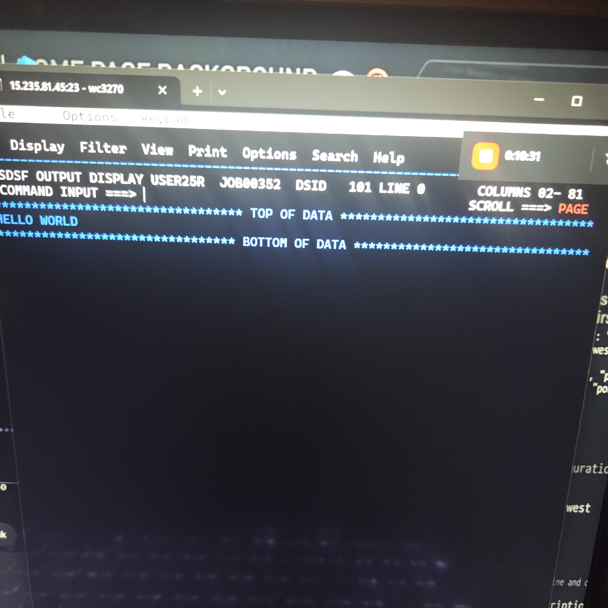
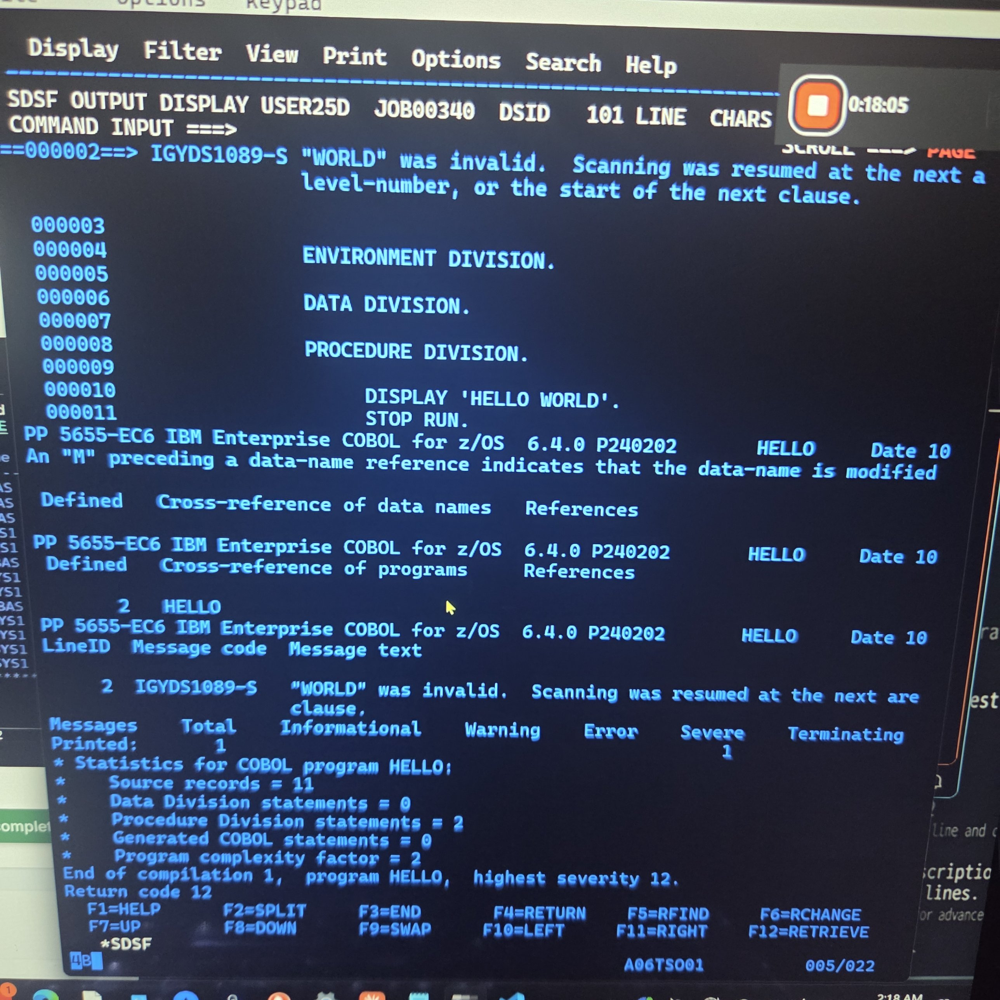
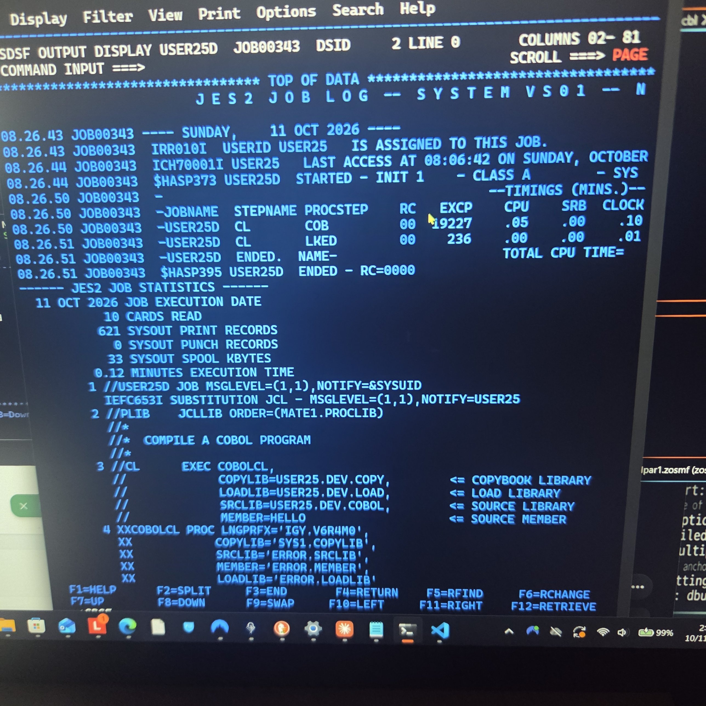

# z/OS COBOL Hello World

My first COBOL program on an IBM z/OS mainframe: written in ISPF, compiled and link-edited with JCL, run as a batch job, and debugged with SDSF.



## Environment

| Item | Value |
|---|---|
| System | IBM z/OS (system VS01), JES2 |
| Terminal | wc3270 (TN3270 emulator) |
| Interface | ISPF 8.1, SDSF |
| Compiler | IBM Enterprise COBOL for z/OS 6.4 (`IGY.V6R4M0`) |
| Compile procedure | `COBOLCL` (compile + link-edit), from `MATE1.PROCLIB` |

## Repository layout

| File | Mainframe dataset | Purpose |
|---|---|---|
| [`cobol/HELLO.cbl`](cobol/HELLO.cbl) | `USER25.DEV.COBOL(HELLO)` | COBOL source |
| [`jcl/COBCOMP.jcl`](jcl/COBCOMP.jcl) | `USER25.DEV.JCL(COBCOMP)` | Compiles and links `HELLO` into `USER25.DEV.LOAD(HELLO)` |
| [`jcl/RUNHELLO.jcl`](jcl/RUNHELLO.jcl) | `USER25.DEV.JCL(RUNHELLO)` | Runs the load module and writes output to `SYSOUT` |

## The workflow

```
 ISPF Edit (=2)          JCL: COBCOMP              JCL: RUNHELLO            SDSF (=S)
┌──────────────┐  SUB  ┌─────────────────┐  SUB  ┌─────────────────┐     ┌──────────────┐
│ HELLO.cbl    │ ────► │ COB  → compile  │ ────► │ EXEC PGM=HELLO  │ ──► │ SYSOUT:      │
│ (source)     │       │ LKED → link     │       │ STEPLIB=LOAD    │     │ HELLO WORLD  │
└──────────────┘       │ → DEV.LOAD      │       └─────────────────┘     └──────────────┘
                       └─────────────────┘
```

1. **Write** the program in ISPF Edit (`=2`) as `USER25.DEV.COBOL(HELLO)`.
2. **Compile and link** by opening `USER25.DEV.JCL(COBCOMP)` and typing `SUB` on the command line. The `COB` step compiles the source and the `LKED` step link-edits it into `USER25.DEV.LOAD(HELLO)`.
3. **Run** by submitting `USER25.DEV.JCL(RUNHELLO)`, which executes `PGM=HELLO` from the load library.
4. **Check results** in SDSF (`=S`, then `ST`). Type `?` next to a job to list its outputs and `S` to open one.

## Debugging log

### Error 1: `MAXCC=0012` on the compile job

The first compile job ended with:

```
JOB00340 $HASP165 USER25D ENDED AT N1 MAXCC=0012 CN(INTERNAL)
```

Return codes: `0000` success, `0004` warnings, `0008`+ failure.

**Finding the job in SDSF.** `ST` showed an empty list because of SDSF's default filter. Fixed with:

```
PREFIX USER25*
OWNER USER25
ST
```

**Finding the failing step.** In `JESYSMSG`, `F 'COND CODE'` showed the compile step failed and the link step was skipped:

```
IEF142I USER25D COB CL - STEP WAS EXECUTED - COND CODE 0012
IEF202I USER25D LKED CL - STEP WAS NOT RUN BECAUSE OF CONDITION CODES
```

**Reading the compiler error.** The `SYSPRINT` for step `COB`, searched with `F '-S '`:



```
2  IGYDS1089-S  "WORLD" was invalid. Scanning was resumed at the next area "A"
                item, level-number, or the start of the next clause.
```

**Cause:** line 2 was `PROGRAM-ID. HELLO WORLD.` A program name cannot contain a space.

**Fix:** changed it to `PROGRAM-ID. HELLO.`

### Result: clean compile



```
-JOBNAME  STEPNAME PROCSTEP    RC
-USER25D  CL       COB         00
-USER25D  CL       LKED        00
$HASP395 USER25D  ENDED - RC=0000
```

### Error 2: typo in the run JCL

The first draft of `RUNHELLO` had `EXEC PMG=HELLO.` The keyword must be `PGM`, and JCL statements don't end with a period. Corrected to:

```
//RUN      EXEC PGM=HELLO
```

### Result: program output

Job `USER25R (JOB00352)` → `SYSOUT`:

```
HELLO WORLD
```

## Lessons learned

- **Submit JCL, not source.** `SUB` belongs on the JCL member. Submitting a COBOL member fails because it has no `JOB` card.
- **Compile and link only build the program.** You need a separate `EXEC PGM=` job with a `STEPLIB` pointing at the load library to run it.
- **Read errors top-down.** `MAXCC` in the job end message → `COND CODE` per step in `JESYSMSG` → the compiler's `-S` messages in `SYSPRINT`.
- **COBOL column rules.** Area A (columns 8–11) holds division, section and paragraph headers. Area B (columns 12–72) holds statements.
- **JCL column rules.** `//` goes in columns 1–2. In the ISPF editor, type only in the data area, never in the 6-digit line-number column (that causes `X Protected`). Press Reset (Esc or Ctrl+R in wc3270) to unlock the keyboard.
- **Useful ISPF editor commands:** `I10` in the line-number column inserts 10 blank lines, `SUB` submits, and F3 saves and exits.

## Reusing this for new programs

1. Create the new source member in `USER25.DEV.COBOL`.
2. In `COBCOMP`, change `MEMBER=HELLO` to the new member name and submit.
3. In `RUNHELLO`, change `PGM=HELLO` to the new program name and submit.
